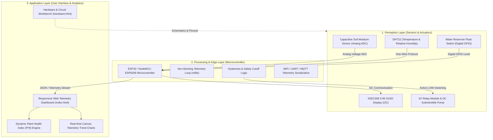

# Smart Plant Monitoring & Precision Irrigation System

[](https://syesh.github.io/iot-project/)
[](docs/CIRCUIT_DIAGRAM.md)
[](firmware/diagram.json)
[](index.html)
[](docs/PROJECT_REPORT.md)

An end-to-end autonomous IoT precision irrigation and environmental monitoring system built with dual-platform firmware (**ESP32** & **NodeMCU ESP8266**), online **Wokwi** microcontroller hardware simulation, and a real-time **interactive telemetry dashboard**.

---

## 🌐 Live Web Demo

You can interact with the live telemetry dashboard and hardware workbench directly in your browser:

> 👉 **[https://syesh.github.io/iot-project/](https://syesh.github.io/iot-project/)**

- **Live Telemetry & Simulation Console:** [`index.html`](https://syesh.github.io/iot-project/index.html)
- **Hardware Architecture & Circuit Workbench:** [`hardware.html`](https://syesh.github.io/iot-project/hardware.html)

---

## 📌 Table of Contents

- [Key Features](#-key-features)
- [System Architecture (3-Tier Model)](#-system-architecture-3-tier-model)
- [Control Algorithms & Mathematical Models](#-control-algorithms--mathematical-models)
  - [Dual-Threshold Hysteresis Irrigation](#1-dual-threshold-hysteresis-irrigation)
  - [Dynamic Plant Health Index (PHI)](#2-dynamic-plant-health-index-phi)
- [Hardware Architecture & Pinout](#-hardware-architecture--pinout)
  - [Bill of Materials (BOM)](#bill-of-materials-bom)
  - [ESP32 Pinout](#esp32-wokwi--hardware-pinout)
  - [NodeMCU ESP8266 Pinout](#nodemcu-esp8266-pinout)
- [Software & Simulation Environments](#-software--simulation-environments)
  - [1. Standalone Web Dashboard (`index.html`)](#1-standalone-web-dashboard-indexhtml)
  - [2. Wokwi Microcontroller Circuit Simulator](#2-wokwi-microcontroller-circuit-simulator)
  - [3. Physical Microcontroller Flashing](#3-physical-microcontroller-flashing)
- [Repository Structure](#-repository-structure)
- [Deploying to GitHub Pages](#-deploying-to-github-pages)
- [Documentation & Reports](#-documentation--reports)
- [Contributors & Team](#-contributors--team)

---

## ✨ Key Features

1. **Closed-Loop Precision Irrigation (Hysteresis Control):**
   - Implements anti-chatter dual thresholds ($T_{\text{dry}} = 30\%$, $T_{\text{target}} = 65\%$) to eliminate rapid relay cycling and prevent pump switch burnout.
2. **Multi-Factor Sensing & Telemetry:**
   - **Soil Moisture:** Capacitive dielectric sensing (corrosion-free, immune to galvanic degradation).
   - **Ambient Climate:** DHT22 high-precision temperature ($-40^\circ\text{C}$ to $+80^\circ\text{C}$) and relative humidity ($0–100\% \text{ RH}$).
   - **Reservoir Level:** Magnetic float switch / digital probe monitoring water reservoir level.
3. **Multi-Tier Fail-Safe Protections:**
   - **Dry-Run Lockout:** Shuts down the pump instantly and triggers an audible buzzer alarm if the reservoir is depleted.
   - **Watchdog Timer:** Automatically enforces a 10–15 second maximum continuous pumping cutoff to prevent pot flooding if a sensor disconnects.
   - **Asynchronous Execution:** Non-blocking `millis()` timing loops prevent UI and sensor sampling freezing.
4. **Adaptive Crop Profiles:**
   - Preset threshold curves dynamically tuned for **Succulents**, **Foliage Houseplants**, **Fruiting Vegetables**, and **Tropical Ferns**.
5. **Dynamic Plant Health Index (PHI):**
   - Weighted algorithmic health score evaluating moisture ($50\%$), temperature ($25\%$), and humidity ($25\%$) against optimal botanical bands.
6. **Dual Simulation Environments:**
   - Zero-dependency client-side dashboard with live SVG gauges, real-time Canvas charts, and automated dry/replenish demo mode.
   - Complete Wokwi ESP32 circuit layout with virtual potentiometer, DHT22, SSD1306 I2C OLED screen, relay, LED, and buzzer.

---

## 🏗 System Architecture (3-Tier Model)



---

## 📐 Control Algorithms & Mathematical Models

### 1. Dual-Threshold Hysteresis Irrigation

Single-threshold systems suffer from **relay chattering** (rapid oscillating on/off transitions when measurements hover around the boundary). The firmware implements a dual-threshold state machine:

$$\text{Pump Action} = \begin{cases} 
\text{Turn ON}, & \text{if } M_t < T_{\text{dry}} \text{ and } W_t = \text{OK} \\
\text{Turn OFF}, & \text{if } M_t \ge T_{\text{target}} \text{ or } t_{\text{run}} \ge t_{\text{max}} \text{ or } W_t = \text{LOW} \\
\text{Hold State}, & \text{if } T_{\text{dry}} \le M_t < T_{\text{target}}
\end{cases}$$

- $M_t$: Instantaneous calibrated moisture reading (%).
- $T_{\text{dry}}$: Low moisture trigger threshold (default $30\%$).
- $T_{\text{target}}$: Soil saturation cutoff target (default $65\%$).
- $W_t$: Reservoir float state (`HIGH` = OK, `LOW` = Empty).
- $t_{\text{run}}$: Continuous pump run time monitored via `millis()`.
- $t_{\text{max}}$: Safety timeout ($10$–$15$ seconds max).

### 2. Dynamic Plant Health Index (PHI)

The composite health score ($0–100\%$) is formulated as:

$$\text{PHI} = w_m \cdot S(M) + w_t \cdot S(T) + w_h \cdot S(H)$$

$$\text{with weights: } w_m = 0.50,\quad w_t = 0.25,\quad w_h = 0.25$$

Target comfort bands:
- **Soil Moisture ($M$):** $40\% \le M \le 70\%$
- **Ambient Temperature ($T$):** $18^\circ\text{C} \le T \le 28^\circ\text{C}$
- **Relative Humidity ($H$):** $45\% \le H \le 75\%$

---

## 🔌 Hardware Architecture & Pinout

### Bill of Materials (BOM)

| # | Component | Specification | Purpose |
| :-: | :--- | :--- | :--- |
| 1 | **ESP32 DevKit v1 / NodeMCU ESP8266** | 32-bit Wi-Fi MCU, micro-USB | Edge controller & processing |
| 2 | **Capacitive Soil Moisture Sensor v1.2** | Analog output, corrosion resistant | Soil water content measurement |
| 3 | **DHT22 (AM2302) Sensor** | Digital relative temp & humidity | Ambient microclimate monitoring |
| 4 | **1-Channel 5V Relay Module** | Optocoupler isolated, 10A 250VAC | Pump electrical isolation & drive |
| 5 | **Mini Submersible DC Pump** | 3V–5V DC, 120 L/hr | Water delivery actuator |
| 6 | **0.96" I2C OLED Display** | SSD1306, 128x64 resolution (0x3C) | Real-time local physical telemetry |
| 7 | **Water Float Level Switch** | Magnetic reed switch | Reservoir dry-run safety lockout |
| 8 | **Passive Piezo Buzzer & LEDs** | 5V Buzzer, 5mm Blue/Green LEDs | Acoustic & visual alert indicators |

### ESP32 (Wokwi & Hardware) Pinout

| Component | Pin / Interface | ESP32 GPIO | Description |
| :--- | :--- | :--- | :--- |
| **Soil Moisture Sensor** | Analog SIG | `GPIO 34` | ADC1 Channel 6 (12-bit, 0–4095) |
| **DHT22 Temp & Humidity** | DATA | `GPIO 15` | Single-bus digital communication |
| **SSD1306 OLED Display** | SDA / SCL | `GPIO 21` / `GPIO 22` | I2C Data & Clock (Address `0x3C`) |
| **5V Relay (Water Pump)** | Control IN | `GPIO 23` | Digital Output (Active LOW / HIGH) |
| **Pump Status LED** | Anode (+) | `GPIO 4` | Visual indicator for active irrigation |
| **Piezo Buzzer** | Positive (+) | `GPIO 18` | Acoustic alert for dry reservoir |
| **Tank Float Switch** | Terminal 1 | `GPIO 19` | Digital input with internal `INPUT_PULLUP` |
| **System Heartbeat LED** | Onboard LED | `GPIO 2` | System power & cycle indicator |

### NodeMCU ESP8266 Pinout

| Component | Component Pin | NodeMCU Pin | GPIO | Function |
| :--- | :--- | :--- | :--- | :--- |
| **Soil Moisture Sensor** | Analog OUT | `A0` | `ADC0` | 10-bit Analog Input (0–1023) |
| **5V Relay Module** | IN | `D1` | `GPIO 5` | Relay digital trigger |
| **DHT22 / DHT11 Sensor** | DATA | `D2` | `GPIO 4` | Digital environmental reading |
| **Reservoir Float Switch** | Signal | `D6` | `GPIO 12` | Digital input (`INPUT_PULLUP`) |
| **System Status LED** | Anode (+) | `D7` | `GPIO 13` | Normal operation heartbeat |
| **Piezo Buzzer** | Positive (+) | `D8` | `GPIO 15` | Low water acoustic warning |

---

## 💻 Software & Simulation Environments

### 1. Standalone Web Dashboard (`index.html`)

No installation, build step, or server configuration required.

1. Open [`index.html`](file:///index.html) in Chrome, Edge, Firefox, or Safari (or visit the [GitHub Pages Live Demo](https://syesh.github.io/iot-project/)).
2. **Interactive Controls:**
   - Click **"Simulate dry soil"** to drop moisture below $30\%$ and watch the pump automatically switch ON.
   - Click **"Add water"** to raise soil moisture past $65\%$ and trigger automatic cutoff.
   - Click **"Run auto demo"** to run an automated drying, alert, irrigation, and recovery cycle.
   - Use the **Crop Presets** to see thresholds automatically adapt for Succulents, Houseplants, and Tropical plants.
   - Switch to [`hardware.html`](hardware.html) to inspect pinouts, live simulated UART serial logs (115200 baud), and circuit wiring.

### 2. Wokwi Microcontroller Circuit Simulator

Run the complete embedded system online with simulated hardware:

1. Open [Wokwi ESP32 Simulator](https://wokwi.com/projects/new/esp32).
2. Copy the contents of [`firmware/smart_plant_esp32.ino`](firmware/smart_plant_esp32.ino) into the sketch editor.
3. Replace the `diagram.json` tab with the contents of [`firmware/diagram.json`](firmware/diagram.json).
4. Click **Start Simulation (Play)**:
   - Adjust the **Soil Moisture potentiometer** to change ADC values.
   - Adjust the **DHT22** sliders to change ambient temperature and humidity.
   - Watch the simulated **SSD1306 OLED** update its telemetry display in real-time.
   - Press the **Tank Switch** button to trigger dry-run lockout and sound the piezo alarm.

### 3. Physical Microcontroller Flashing

1. Open Arduino IDE (v2.0+ recommended).
2. Install board packages:
   - For ESP32: `esp32 by Espressif Systems` in Boards Manager.
   - For NodeMCU: `esp8266 by ESP8266 Community` in Boards Manager.
3. Install required libraries via Library Manager:
   - `Adafruit SSD1306` & `Adafruit GFX Library`
   - `DHT sensor library by Adafruit`
4. Select your board and port, open [`firmware/smart_plant_esp32.ino`](firmware/smart_plant_esp32.ino) (or [`firmware/smart_plant_nodemcu.ino`](firmware/smart_plant_nodemcu.ino)), and click **Upload**.
5. Open Serial Monitor at **115200 baud**.

---

## 📁 Repository Structure

```text
iot-project/
├── .github/
│   └── workflows/
│       └── deploy-pages.yml       # Automated GitHub Pages CI/CD deployment
├── docs/
│   ├── CIRCUIT_DIAGRAM.md         # Detailed hardware schematics & wiring tables
│   ├── PROJECT_REPORT.md          # Complete academic engineering report
│   └── TECHNICAL_FAQ.md           # Engineering Viva & Technical Q&A guide
├── firmware/
│   ├── diagram.json               # Wokwi virtual circuit layout & connections
│   ├── smart_plant_esp32.ino      # ESP32 Arduino sketch with OLED & hysteresis
│   ├── smart_plant_nodemcu.ino    # NodeMCU ESP8266 Arduino sketch
│   └── wokwi.toml                 # Wokwi configuration file
├── hardware.html                  # Interactive hardware workbench & UART terminal
├── index.html                     # Live telemetry & simulation dashboard
├── README.md                      # Comprehensive project documentation
└── README.txt                     # Quick-start plain text reference
```

---

## 🚀 Deploying to GitHub Pages

This project is 100% static client-side web technology (HTML5, CSS3, Vanilla JS). It requires no build tools, NodeJS, or backend server.

### Automatic Deployment (Configured via GitHub Actions)

The repository includes a GitHub Actions workflow at [`.github/workflows/deploy-pages.yml`](.github/workflows/deploy-pages.yml).

To activate it:
1. Go to your repository on GitHub: `https://github.com/syesh/iot-project`.
2. Navigate to **Settings** > **Pages** (under "Code and automation").
3. Under **Build and deployment** > **Source**, select:
   - **GitHub Actions** (recommended, uses the included workflow), OR
   - **Deploy from a branch** > branch: `main` > folder: `/ (root)` > click **Save**.
4. Once deployed, your site will be live at:
   > `https://syesh.github.io/iot-project/`

---

## 📚 Documentation & Reports

- **Engineering Project Report:** [`docs/PROJECT_REPORT.md`](docs/PROJECT_REPORT.md)
  - Theoretical foundations, problem statement, 3-tier architecture, mathematical models, and testing results.
- **Circuit Schematic & Pinout Guide:** [`docs/CIRCUIT_DIAGRAM.md`](docs/CIRCUIT_DIAGRAM.md)
  - Detailed breadboard wiring schematics, pinout comparisons, and electrical isolation notes.
- **Technical Architecture & Viva FAQ:** [`docs/TECHNICAL_FAQ.md`](docs/TECHNICAL_FAQ.md)
  - 10+ detailed engineering answers covering capacitive vs. resistive sensing, inductive back-EMF, ADC calibration, and relay chattering.

---

## 👥 Contributors & Team

Developed for the **Internet of Things (IoT) Course Mini Project** (Academic Year 2026–2027).

| Role | Focus Area |
| :--- | :--- |
| **Embedded Firmware** | NodeMCU & ESP32 Arduino sketch logic, hysteresis state machine, safety timers |
| **Circuit & Simulation** | Wokwi virtual schematic design, wiring diagrams, sensor calibration |
| **Frontend & Telemetry** | Interactive web dashboard, real-time Canvas charts, crop preset engine |
| **Documentation & QA** | Academic project report, technical FAQ, fail-safe edge-case validation |
